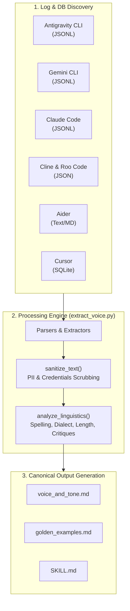
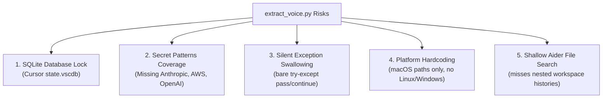

# Deep Review and Analysis: `extract-human-voice` Skill & Repository

## Executive Summary & Architectural Overview

The [extract-human-voice](file:///Users/ksprashanth/code/github/skills-extract-human-voice/skills/extract-human-voice/SKILL.md) skill is an automated pipeline and reference framework designed to extract, sanitize, analyze, and structure a developer's unique writing voice and engineering directives from local conversational logs across **7 major AI developer tools**:

1. **Antigravity CLI** (`~/.gemini/antigravity-cli/brain/`)
2. **Gemini CLI** (`~/.gemini/tmp/`)
3. **Claude Code** (`~/.claude/projects/`)
4. **Cline** (`~/Library/Application Support/Code/User/globalStorage/saoudrizwan.claude-dev/tasks/`)
5. **Roo Code** (`~/Library/Application Support/Code/User/globalStorage/rooveterinaryinc.roo-cline/tasks/`)
6. **Aider** (`~/.aider.history` and `.aider.chat.history.md`)
7. **Cursor** (`~/Library/Application Support/Cursor/User/globalStorage/state.vscdb`)



The architecture bridges raw developer prompt history into reusable, shareable agent skill assets (compatible with `copy-writer-bara` and `npx skills`), ensuring privacy by redacting personally identifiable information (PII), credentials, and corporate internal links prior to output generation.

---

## Component & Structural Analysis

The repository is organized into a modular skill structure conforming to the Agent Skills standard:

| Component Path | Type | Role & Responsibilities |
| :--- | :--- | :--- |
| [SKILL.md](file:///Users/ksprashanth/code/github/skills-extract-human-voice/skills/extract-human-voice/SKILL.md) | Agent Instructions | Core entry point for agents. Defines quick start commands, directory discovery paths, scrubbing conventions, and copybara integration workflows. |
| [REFERENCE.md](file:///Users/ksprashanth/code/github/skills-extract-human-voice/skills/extract-human-voice/REFERENCE.md) | Technical Specification | Details exact storage paths, JSON/JSONL/SQLite schemas, and extraction heuristics for all 7 supported AI coding assistants. |
| [EXAMPLES.md](file:///Users/ksprashanth/code/github/skills-extract-human-voice/skills/extract-human-voice/EXAMPLES.md) | Samples & Mappings | Provides concrete before-and-after scrubbing examples (emails, domains, local paths, tokens) and the critique-to-persona transformation matrix. |
| [extract_voice.py](file:///Users/ksprashanth/code/github/skills-extract-human-voice/skills/extract-human-voice/scripts/extract_voice.py) | Python Engine | Main executable script (`21 KB`, 460 lines). Implements file system discovery, regex scrubbing, schema parsing, linguistic statistics computation, and markdown output generation. |
| [README.md](file:///Users/ksprashanth/code/github/skills-extract-human-voice/README.md) | User Documentation | Public repository documentation including installation instructions (`npx skills add`), disclaimer notice, architecture diagram, and usage examples. |

### In-Depth Inspection of [extract_voice.py](file:///Users/ksprashanth/code/github/skills-extract-human-voice/skills/extract-human-voice/scripts/extract_voice.py)

#### 1. Path Configuration & Discovery (`PATHS`)
Lines 27–35 define the standard macOS target locations:
```python
PATHS = {
    "antigravity-cli": os.path.join(HOME, ".gemini", "antigravity-cli", "brain"),
    "gemini-cli": os.path.join(HOME, ".gemini", "tmp"),
    "claude-code": os.path.join(HOME, ".claude", "projects"),
    "cline": os.path.join(HOME, "Library", "Application Support", "Code", "User", "globalStorage", "saoudrizwan.claude-dev", "tasks"),
    "roo-code": os.path.join(HOME, "Library", "Application Support", "Code", "User", "globalStorage", "rooveterinaryinc.roo-cline", "tasks"),
    "aider": HOME,
    "cursor": os.path.join(HOME, "Library", "Application Support", "Cursor", "User")
}
```

#### 2. Sanitization & Scrubbing Engine (`sanitize_text`)
Lines 38–82 define `PII_PATTERNS` and `NAME_PATTERNS`. Key sanitization targets:
- Email addresses -> `<EMAIL>`
- IP addresses -> `<IP_ADDRESS>`
- Internal Google domains/URLs -> `<COMPANY_DOMAIN>`, `<INTERNAL_URL>`
- Tokens/Secrets -> `<REDACTED_API_KEY>`, `<REDACTED_GITHUB_TOKEN>`, `<REDACTED_JWT_TOKEN>`
- System User paths (`/Users/<username>`) -> `/Users/<USER_ID>`

#### 3. Data Parsers
- `extract_antigravity_cli()` (lines 84–106): Searches recursively for `transcript.jsonl` files and filters for `type == "USER_INPUT"` or `source == "USER_EXPLICIT"`.
- `extract_gemini_cli()` (lines 107–129): Parses `chats/*.jsonl` for `role == "user"`, `user_input`, or `sender == "user"`.
- `extract_claude_code()` (lines 131–154): Handles `chat_*.jsonl`, supporting both string content and structured text block arrays (`[{ "type": "text", "text": "..." }]`).
- `extract_cline_and_roo_code()` (lines 156–178): Parses `ui_messages.json` arrays for `say == "user_feedback"` or `role == "user"`.
- `extract_aider()` (lines 180–217): Reads `~/.aider.history` lines and blockquotes (`> `) in `.aider.chat.history.md`.
- `extract_cursor()` (lines 219–252): Connects to `state.vscdb` SQLite database, queries `globalState` for keys matching `%chat%` or `%composer%`, and uses regex extraction on nested JSON strings.

#### 4. Linguistic Heuristics (`analyze_linguistics`)
Lines 253–306 compute metrics across unique extracted prompts:
- Average word count per prompt
- Commonwealth/British vs US English spelling detection (`colour`, `behaviour`, `optimise`, `prioritise`)
- Punctuation markers (`...`, `??`)
- Technical critique triggers (`useless`, `waste`, `meh`, `revert`, `broken`, `hung`, `slow`)

---

## Strengths & Unique Capabilities

1. **Broad Tool Coverage**: Seamlessly unifies conversation logs across 7 distinct AI tools into a single profile.
2. **Privacy-Preserving Design**: Built-in sanitization ensures extracted profiles can be safely checked into git repositories or published via `npx skills`.
3. **Constructive Friction Transformation**: Converts developer frustration triggers (e.g. "hung", "meh layout", "redundant tasks") into high-value engineering principles (strict thread isolation, rich visual layouts, verified domain grounding).
4. **Standards Compliance**: Fully aligns with Agent Skills specifications, providing clear separation between core instructions ([SKILL.md](file:///Users/ksprashanth/code/github/skills-extract-human-voice/skills/extract-human-voice/SKILL.md)), reference specifications ([REFERENCE.md](file:///Users/ksprashanth/code/github/skills-extract-human-voice/skills/extract-human-voice/REFERENCE.md)), and executable code ([extract_voice.py](file:///Users/ksprashanth/code/github/skills-extract-human-voice/skills/extract-human-voice/scripts/extract_voice.py)).

---

## Gaps, Security & Edge Case Vulnerabilities

During deep code review, several critical edge cases and potential failure modes were identified:



### 1. SQLite Database Lock in Cursor Integration
In [extract_voice.py:L229](file:///Users/ksprashanth/code/github/skills-extract-human-voice/skills/extract-human-voice/scripts/extract_voice.py#L229):
```python
conn = sqlite3.connect(db_file)
```
When Cursor is actively open, `state.vscdb` is locked by VS Code / Cursor. Standard `sqlite3.connect()` will fail with `sqlite3.OperationalError: database is locked`. Because it is wrapped in `try...except Exception: pass`, Cursor history is silently skipped without warning the user.

### 2. Secret Scrubbing Patterns Coverage
In [extract_voice.py:L38-L48](file:///Users/ksprashanth/code/github/skills-extract-human-voice/skills/extract-human-voice/scripts/extract_voice.py#L38-L48), `PII_PATTERNS` targets Google Cloud keys, GitHub PATs (`ghp_`), and JWTs, but lacks patterns for:
- Anthropic API Keys (`sk-ant-api03-...`)
- OpenAI API Keys (`sk-...`)
- AWS Access Key IDs (`AKIA...`)
- GitHub Fine-Grained Personal Access Tokens (`github_pat_...`)
- GitLab Personal Access Tokens (`glpat-...`)

### 3. Silent Exception Swallowing
Across all extractor functions ([extract_voice.py:L103](file:///Users/ksprashanth/code/github/skills-extract-human-voice/skills/extract-human-voice/scripts/extract_voice.py#L103), [L127](file:///Users/ksprashanth/code/github/skills-extract-human-voice/skills/extract-human-voice/scripts/extract_voice.py#L127), [L152](file:///Users/ksprashanth/code/github/skills-extract-human-voice/skills/extract-human-voice/scripts/extract_voice.py#L152), [L176](file:///Users/ksprashanth/code/github/skills-extract-human-voice/skills/extract-human-voice/scripts/extract_voice.py#L176), [L215](file:///Users/ksprashanth/code/github/skills-extract-human-voice/skills/extract-human-voice/scripts/extract_voice.py#L215), [L246](file:///Users/ksprashanth/code/github/skills-extract-human-voice/skills/extract-human-voice/scripts/extract_voice.py#L246)), errors during file reading or JSON parsing are caught with bare `except Exception: continue` or `pass`. This obscures syntax errors or schema changes in newer tool versions.

### 4. OS & Environment Hardcoding
The `PATHS` dictionary uses macOS-specific paths under `~/Library/Application Support/`. On Linux or Windows (WSL), paths reside under `~/.config/` or `%APPDATA%`.

### 5. Limited Search Depth for Aider History
In [extract_voice.py:L196-L201](file:///Users/ksprashanth/code/github/skills-extract-human-voice/skills/extract-human-voice/scripts/extract_voice.py#L196-L201), Aider chat history files (`.aider.chat.history.md`) are searched using rigid 1-level glob patterns:
```python
search_paths = [
    os.path.join(HOME, ".aider.chat.history.md"),
    os.path.join(HOME, "*", ".aider.chat.history.md"),
    os.path.join(HOME, "code", "*", ".aider.chat.history.md"),
    os.path.join(HOME, "git", "*", ".aider.chat.history.md")
]
```
If a user stores projects deeper (e.g. `~/code/github/org/repo/`), those chat histories will not be discovered.

---

## Actionable Recommendations & Enhancements

To upgrade `extract-human-voice` to enterprise grade, the following improvements are recommended:

### Recommendation 1: Fix SQLite Connection to Handle Locked DBs
Update `extract_cursor()` to open `state.vscdb` using URI mode with `mode=ro` and `immutable=1` (or fallback to copying the DB file to a temporary location before querying):
```python
# Read-only non-blocking URI connection for SQLite
db_uri = f"file:{db_file}?mode=ro&immutable=1"
conn = sqlite3.connect(db_uri, uri=True)
```

### Recommendation 2: Expand Secret Scrubbing Regex Rules
Add comprehensive regex rules for modern AI provider keys and cloud credentials:
```python
PII_PATTERNS.extend([
    (r'sk-ant-[a-zA-Z0-9_-]{40,}', '<REDACTED_ANTHROPIC_KEY>'),
    (r'sk-[a-zA-Z0-9]{32,}', '<REDACTED_OPENAI_KEY>'),
    (r'AKIA[0-9A-Z]{16}', '<REDACTED_AWS_ACCESS_KEY>'),
    (r'github_pat_[a-zA-Z0-9_]{80,}', '<REDACTED_GITHUB_PAT>'),
    (r'glpat-[a-zA-Z0-9_-]{20,}', '<REDACTED_GITLAB_PAT>')
])
```

### Recommendation 3: Add Verbose / Debug Logging Flag
Introduce a `--verbose` CLI argument to print detailed extraction counts, skipped files, and encountered errors rather than suppressing them silently:
```python
import argparse
parser = argparse.ArgumentParser(description="Extract human writing voice from AI tool logs.")
parser.add_argument("-v", "--verbose", action="store_true", help="Enable verbose diagnostic output")
args = parser.parse_args()
```

### Recommendation 4: Cross-Platform Path Resolution
Implement cross-platform path resolution using `platform.system()` to support Linux and Windows environments:
```python
import platform

def get_tool_paths():
    system = platform.system()
    if system == "Darwin":
        app_support = os.path.join(HOME, "Library", "Application Support")
    elif system == "Linux":
        app_support = os.environ.get("XDG_CONFIG_HOME", os.path.join(HOME, ".config"))
    elif system == "Windows":
        app_support = os.environ.get("APPDATA", os.path.join(HOME, "AppData", "Roaming"))
    else:
        app_support = HOME

    return {
        "antigravity-cli": os.path.join(HOME, ".gemini", "antigravity-cli", "brain"),
        "cline": os.path.join(app_support, "Code", "User", "globalStorage", "saoudrizwan.claude-dev", "tasks"),
        "cursor": os.path.join(app_support, "Cursor", "User")
        # ...
    }
```

### Recommendation 5: Unit Test Suite
Add a `tests/` directory with `pytest` verifications for:
1. `sanitize_text()` edge cases (nested emails, multiline credentials, user home substitution).
2. `analyze_linguistics()` accuracy on mock prompt datasets.
3. Schema parsing validity on mock JSON/JSONL sample files.

---

## Conclusion

The [skills-extract-human-voice](file:///Users/ksprashanth/code/github/skills-extract-human-voice) project provides a well-designed, highly practical skill pipeline. By applying the recommended SQLite read-only URI fixes, expanding secret scrubbing patterns, and adding cross-platform path discovery, this skill will achieve robust, production-grade reliability across all developer environments.
